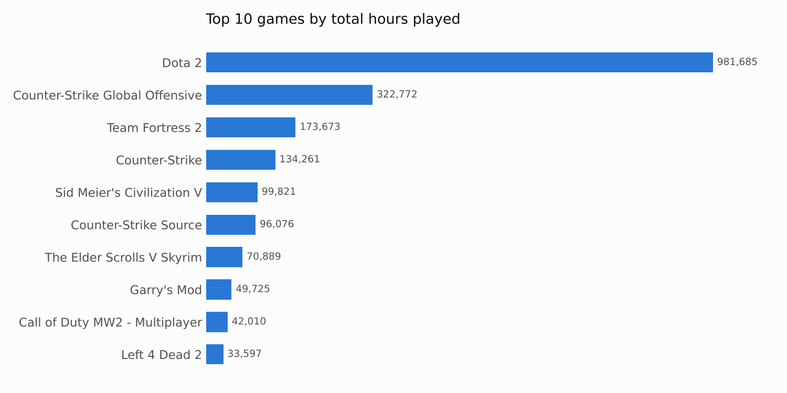

# Steam Game Recommender System with Spark MLlib

A collaborative filtering recommender that suggests video games to Steam users based on what they and similar players have played. Built with Apache Spark MLlib on Databricks, using the Alternating Least Squares (ALS) algorithm, with experiments tracked in MLflow. The full workflow is in [steam_game_recommender.ipynb](steam_game_recommender.ipynb), with all outputs saved.

---

## The business problem

A game store has thousands of titles, and most players will only ever discover a small fraction of them. Showing each player the games they are most likely to enjoy keeps them engaged and drives sales. Players rarely rate games, but their behaviour says a lot: what they buy and, above all, how long they play. The goal was to turn that behaviour into personalised recommendations.

## The data

200,000 interactions from Steam: 12,393 users and 5,155 games. Each row records a user, a game, the behaviour (purchase or play) and, for play rows, the number of hours played.

Exploration showed:

- **129,511 purchases and 70,489 play records.** Many purchased games were never played.
- **Play time is extremely skewed.** The average is about 49 hours, but the standard deviation is about 229 hours and one user logged 11,754 hours in a single game.
- **Dota 2 dominates**, with nearly 982,000 hours, three times the next game.
- **Libraries vary hugely in size.** Users own about 10 games on average, but one owns 1,075.

## Approach

1. **Exploration.** Summaries were built with PySpark DataFrames and cross-checked with Spark SQL, so every figure was confirmed two ways.
2. **Integer IDs for games.** ALS needs numeric IDs, but games only have names. MLlib's StringIndexer generated an ID for every game inside Spark, ordered by popularity, without relying on an external lookup file. A separate games list was used only to confirm all 5,155 games were covered.
3. **Choosing the signal.** Play hours were used as implicit feedback, because time spent says far more about preference than a purchase flag that is always 1. A log transform, log(1 + hours), compressed the extreme values so a few heavy players did not drown out everyone else.
4. **Train and test split.** 80% of the data was used for training and 20% was held back for final testing, with a fixed seed so results can be reproduced.
5. **Baseline model.** ALS was trained in implicit feedback mode, with a cold-start strategy that drops users and games not seen in training.
6. **Hyperparameter tuning.** A grid search over 15 combinations of rank (number of latent factors) and regularisation strength used a train-validation split inside the training data. Every run was logged automatically in MLflow.
7. **Recommendations.** The best model scored every unplayed game for an individual user, and produced a top 10 for all 9,988 users in the training data in one distributed pass.

## Results

**Recommendations make sense.** A user whose most-played games are The Elder Scrolls V: Skyrim, Fallout 4, Spore and Fallout: New Vegas is recommended:

| Rank | Recommended game | Score |
|---|---|---|
| 1 | Terraria | 0.61 |
| 2 | Borderlands 2 | 0.53 |
| 3 | Portal 2 | 0.51 |
| 4 | Sid Meier's Civilization V | 0.46 |
| 5 | Warframe | 0.37 |

**Tuning had almost no effect on RMSE, and that is a finding in itself.** The best model (rank 10, regularisation 0.01) scored a test RMSE of 2.4040 against the baseline's 2.4055. In implicit mode, ALS predicts a preference score between roughly 0 and 1, while the test labels are log play hours of up to about 9. RMSE therefore mostly measures that difference in scale, which no hyperparameter can close. It is a useful sanity check, but it is the wrong yardstick for a recommender, which should be judged on whether the games people actually play appear near the top of their list.

## Next steps

- **Evaluate with ranking metrics** such as precision at k, mean average precision and NDCG, using MLlib's RankingEvaluator.
- **Tune alpha**, the parameter that controls how much extra play time increases confidence. It was left at its default and is likely to matter more than regularisation.
- **Use purchases as a weaker signal** alongside play time, instead of discarding them.
- **Handle cold start** with popularity-based recommendations for new users and games.

## Tools

Apache Spark (PySpark, Spark SQL, MLlib), Databricks, MLflow, Python.

## Data source

Steam Video Games dataset (steam-200k), originally published on Kaggle by Tamber. The data is not included in this repository.
